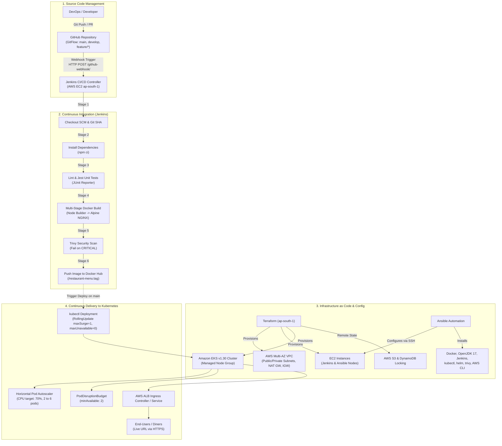

# Restaurant Menu & Order Visualizer — Production Cloud & DevOps Architecture

[](https://aws.amazon.com/)
[](https://kubernetes.io/)
[](https://www.jenkins.io/)
[](https://hub.docker.com/)
[](https://www.terraform.io/)
[](https://www.ansible.com/)
[](https://jestjs.io/)

A complete, production-grade DevOps engineering demonstration showcasing the lifecycle of a cloud-native single-page application: **Restaurant Menu & Order Visualizer**. The architecture implements GitFlow governance, multi-stage hardened containerization, automated Jenkins CI/CD with Trivy vulnerability scanning, modular Terraform infrastructure provisioning in AWS (`ap-south-1` Mumbai), configuration management via Ansible, and zero-downtime Kubernetes deployments with autoscaling and self-healing.

---

## 1. End-to-End DevOps Architecture



---

## 2. Repository Directory Structure

```text
Restaurant-Menu-Order-Visualizer/
├── .github/
│   └── pull_request_template.md   # PR review checklist & quality gates
├── .gitignore                     # Git ignore rules for Node, Terraform, Ansible, Docker
├── .dockerignore                  # Docker build context exclusions
├── README.md                      # Complete system documentation & runbook
├── app/                           # Frontend application source code
│   ├── app.js                     # Reactive UI, cart state, and modal controllers
│   ├── health.html                # Static probe endpoint for K8s & ALB health checks
│   ├── index.html                 # Semantic HTML5 luxury dark-mode interface
│   ├── logic.js                   # Pure business logic (filtering, calculations, order IDs)
│   ├── menu.json                  # Digital menu database (20 dishes, 4 categories, dietary tags)
│   ├── package.json               # Node.js project descriptor and Jest test scripts
│   ├── styles.css                 # Vanilla CSS design system (modern luxury dining theme)
│   └── tests/
│       └── logic.test.js          # Jest unit test suite (20 tests, 100% passing)
├── docker/                        # Containerization assets
│   ├── .dockerignore              # Docker build context exclusions
│   ├── Dockerfile                 # Hardened multi-stage build (Node -> unprivileged Alpine NGINX)
│   └── nginx.conf                 # Hardened NGINX config with non-root port 8080 and security headers
├── jenkins/                       # Jenkins CI/CD pipeline
│   └── Jenkinsfile                # Declarative 8-stage pipeline with Trivy & K8s deployment
├── terraform/                     # AWS Infrastructure as Code (ap-south-1)
│   ├── backend.tf                 # S3 remote state storage with DynamoDB state locking
│   ├── main.tf                    # Root orchestration module
│   ├── variables.tf               # Input variable declarations
│   ├── outputs.tf                 # Infrastructure connection outputs
│   ├── terraform.tfvars.example   # Sample input values
│   └── modules/
│       ├── vpc/                   # Multi-AZ VPC, subnets, IGW, NAT Gateways
│       ├── security/              # Security groups & IAM roles
│       ├── ec2/                   # EC2 instances (Jenkins & Ansible nodes)
│       └── eks/                   # Managed Kubernetes cluster (AWS EKS & node groups)
├── ansible/                       # Configuration Management & Node Provisioning
│   ├── ansible.cfg                # Global Ansible configuration
│   ├── inventory.ini              # Host inventory
│   ├── site.yml                   # Master playbook orchestration
│   ├── group_vars/
│   │   ├── all.yml                # Environment variables and package versions
│   │   └── vault.yml              # Ansible Vault encrypted credentials
│   └── roles/
│       ├── common/                # OS hardening, swap off, kernel modules, sysctl
│       ├── docker/                # Docker CE & containerd CRI installation
│       ├── jenkins/               # Jenkins LTS, OpenJDK 17, and plugins
│       ├── tools/                 # AWS CLI v2, kubectl, helm, trivy
│       └── app_config/            # Jinja2 template rendering using Vault secrets
└── k8s/                           # Kubernetes Production Manifests
    ├── 00-namespace.yaml          # Isolated namespace: restaurant-app with Restricted PSS
    ├── 01-configmap.yaml          # Application configuration settings
    ├── 02-deployment.yaml         # 3 replicas, RollingUpdate strategy, resource limits, probes
    ├── 03-service.yaml            # ClusterIP service exposing port 80 -> 8080
    ├── 04-ingress.yaml            # Ingress rule for AWS ALB Controller & custom domain
    ├── 05-hpa.yaml                # HorizontalPodAutoscaler (CPU 70%, 2 to 6 pods)
    └── 06-pdb.yaml                # PodDisruptionBudget ensuring at least 2 pods available
```

---

## 3. Step-by-Step Execution Order: Empty AWS Account to Live URL

Follow this exact sequence to deploy the entire stack from scratch:

### Step 1: Clone Repository & Verify Local Application
```bash
git clone https://github.com/<YOUR_GITHUB_USERNAME>/restaurant-menu-order-visualizer.git
cd restaurant-menu-order-visualizer

# Run unit tests locally
cd app
npm install
npm test
cd ..
```

### Step 2: Configure AWS Credentials & S3 Backend Prerequisite
Set your AWS access credentials for region `ap-south-1`:
```bash
export AWS_DEFAULT_REGION="ap-south-1"
export AWS_ACCESS_KEY_ID="AKIAxxxxxxxxxxxxxxxx"
export AWS_SECRET_ACCESS_KEY="xxxxxxxxxxxxxxxxxxxxxxxxxxxxxxxxxxxxxxxx"

# Create S3 Bucket and DynamoDB Table for Terraform State Locking
aws s3api create-bucket \
  --bucket restaurant-terraform-state-ap-south-1 \
  --region ap-south-1 \
  --create-bucket-configuration LocationConstraint=ap-south-1

aws dynamodb create-table \
  --table-name restaurant-terraform-locks \
  --attribute-definitions AttributeName=LockID,AttributeType=S \
  --key-schema AttributeName=LockID,KeyType=HASH \
  --billing-mode PAY_PER_REQUEST \
  --region ap-south-1
```

### Step 3: Provision AWS Infrastructure via Terraform
```bash
cd terraform

# Generate local SSH key pair if you don't already have one
ssh-keygen -t ed25519 -f ~/.ssh/id_rsa -N ""

# Copy example variables and insert your public SSH key
cp terraform.tfvars.example terraform.tfvars
sed -i "s|ssh-ed25519.*|$(cat ~/.ssh/id_rsa.pub)|g" terraform.tfvars

# Initialize, Plan, and Apply
terraform init
terraform validate
terraform plan -out=tfplan.binary
terraform apply tfplan.binary -auto-approve

# Save connection outputs
JENKINS_IP=$(terraform output -raw jenkins_public_ip)
ANSIBLE_IP=$(terraform output -raw ansible_public_ip)
EKS_CLUSTER=$(terraform output -raw eks_cluster_name)

# Configure local kubectl to communicate with EKS
aws eks update-kubeconfig --region ap-south-1 --name "$EKS_CLUSTER"
kubectl get nodes

cd ..
```

### Step 4: Configure EC2 Nodes via Ansible
```bash
cd ansible

# Update inventory.ini with Terraform output IPs
sed -i "s|13.233.100.51|$JENKINS_IP|g" inventory.ini
sed -i "s|13.233.100.52|$ANSIBLE_IP|g" inventory.ini

# Test SSH connection
ansible all -m ping -i inventory.ini

# Run the master playbook to install Docker, Jenkins, K8s tools, and Trivy
ansible-playbook -i inventory.ini site.yml

cd ..
```

### Step 5: Configure Jenkins & GitHub Webhook
1. Open Jenkins in your browser: `http://<JENKINS_IP>:8080`.
2. Retrieve initial admin password:
   ```bash
   ssh -i ~/.ssh/id_rsa ubuntu@$JENKINS_IP "sudo cat /var/lib/jenkins/secrets/initialAdminPassword"
   ```
3. Install suggested plugins plus: `GitHub Integration`, `Docker Pipeline`, `Kubernetes CLI`, `JUnit`, `AnsiColor`.
4. Add Credentials in Jenkins:
   - `dockerhub-credentials`: Docker Hub username & Access Token.
   - `k8s-kubeconfig`: Upload cluster kubeconfig (from `~/.kube/config`).
5. Configure GitHub Webhook:
   - Navigate to GitHub Repo &rarr; **Settings** &rarr; **Webhooks** &rarr; **Add webhook**.
   - Payload URL: `http://<JENKINS_IP>:8080/github-webhook/`
   - Content type: `application/json`
   - Events: **Pushes**, **Pull requests**.
6. Create **Multibranch Pipeline** pointing to `jenkins/Jenkinsfile`.

### Step 6: Deploy to Kubernetes
When you push to the `main` branch, Jenkins automatically executes stages 1-8. Alternatively, deploy directly from your workstation:
```bash
# Apply baseline manifests
kubectl apply -f k8s/00-namespace.yaml
kubectl apply -f k8s/01-configmap.yaml
kubectl apply -f k8s/02-deployment.yaml
kubectl apply -f k8s/03-service.yaml
kubectl apply -f k8s/04-ingress.yaml
kubectl apply -f k8s/05-hpa.yaml
kubectl apply -f k8s/06-pdb.yaml

# Monitor rollout status
kubectl rollout status deployment/restaurant-menu-deployment -n restaurant-app

# Retrieve Ingress / LoadBalancer endpoint
kubectl get ingress -n restaurant-app
```
Access the application in your browser via the Ingress ALB hostname or DNS name!

---

## 4. Cost-Saving Tips & Resource Teardown

Deploying production architectures on AWS can incur unexpected costs if left running indefinitely. Follow these best practices:

### Cost-Saving Guidelines
1. **AWS Free Tier Eligible Compute**:
   - The Ansible Control Node can be sized as `t3.micro` or `t3.small`.
   - The Jenkins Controller runs efficiently on `t3.medium` (stop it when not running builds).
2. **Single NAT Gateway Architecture**:
   - Our Terraform module places 1 NAT Gateway in Public Subnet 1 rather than provisioning a NAT Gateway in every AZ. This saves **~$35.00/month** in idle NAT hourly charges.
3. **EKS Spot Instances**:
   - For demo/testing, change `capacity_type = "SPOT"` in `terraform/modules/eks/main.tf` to reduce EC2 worker node costs by up to **70%**.
4. **Stop Instances Overnight**:
   ```bash
   # Stop Jenkins and Ansible nodes when not in use
   aws ec2 stop-instances --instance-ids <JENKINS_INSTANCE_ID> <ANSIBLE_INSTANCE_ID> --region ap-south-1
   ```

### Complete Teardown / Cleanup Guide
To delete all AWS resources and incur **$0 additional charges**:
```bash
# 1. Delete Kubernetes Ingress and Load Balancers first (allows ALB controller to deprovision AWS resources)
kubectl delete -f k8s/04-ingress.yaml
kubectl delete -f k8s/03-service.yaml
kubectl delete namespace restaurant-app

# 2. Destroy all infrastructure via Terraform
cd terraform
terraform destroy -auto-approve

# 3. Clean up S3 State Bucket & DynamoDB Lock Table (Optional)
aws s3 rb s3://restaurant-terraform-state-ap-south-1 --force --region ap-south-1
aws dynamodb delete-table --table-name restaurant-terraform-locks --region ap-south-1
```

---

## 5. Troubleshooting Guide for Common Errors

### Error 1: Jenkins Webhook Fails with HTTP 302 or 403
- **Cause**: Missing trailing slash `/` in GitHub Webhook URL or CSRF crumb issues.
- **Fix**: Ensure Payload URL is strictly `http://<JENKINS_IP>:8080/github-webhook/` (including the trailing slash). Ensure the GitHub Integration plugin is installed.

### Error 2: `docker: Got permission denied while trying to connect to the Docker daemon socket`
- **Cause**: The `jenkins` user is not a member of the `docker` system group.
- **Fix**:
  ```bash
  sudo usermod -aG docker jenkins
  sudo systemctl restart jenkins
  ```

### Error 3: EKS `error: You must be logged in to the server (Unauthorized)`
- **Cause**: The IAM role or user running `kubectl` is not mapped in the EKS `aws-auth` ConfigMap or cluster access entries.
- **Fix**: Update kubeconfig using the exact AWS IAM identity that created the cluster:
  ```bash
  aws eks update-kubeconfig --region ap-south-1 --name restaurant-cluster
  ```

### Error 4: Pods Stuck in `CrashLoopBackOff` or `CreateContainerConfigError`
- **Cause**: Missing ConfigMap or port collision.
- **Fix**:
  ```bash
  kubectl describe pod <POD_NAME> -n restaurant-app
  kubectl logs <POD_NAME> -n restaurant-app --previous
  ```
  Verify that `k8s/01-configmap.yaml` was applied before the deployment.

### Error 5: Kubernetes Ingress Address Shows `<none>`
- **Cause**: AWS Load Balancer Controller is not installed in the cluster, or subnets lack the required ELB discovery tags.
- **Fix**: Verify subnets in Terraform have tags `"kubernetes.io/role/elb" = "1"` and install the AWS Load Balancer Controller via Helm:
  ```bash
  helm repo add eks https://aws.github.io/eks-charts
  helm install aws-load-balancer-controller eks/aws-load-balancer-controller \
    -n kube-system \
    --set clusterName=restaurant-cluster \
    --set serviceAccount.create=true
  ```

---

## 6. Project Submission & Screenshots Checklist

When submitting this project for portfolio review, academic evaluation, or enterprise assessment, capture screenshots of the following milestones:

- [ ] **1. Application UI**:
  - [ ] Food menu displaying categories (Starters, Mains, Desserts, Drinks) and dishes.
  - [ ] Dietary filter in action (e.g., clicking `Vegan` filters list).
  - [ ] Live Cart showing quantity increments and live total updates.
  - [ ] Checkout modal with customer name, table number, and order summary.
  - [ ] Order confirmation popup displaying generated Order ID (e.g. `ORD-XXXXXX`).
  - [ ] Health check probe page at `/health.html`.
- [ ] **2. Automated Unit Tests**:
  - [ ] Terminal screenshot of `npm test` showing 20/20 unit tests passed.
  - [ ] Terminal screenshot of `npm run test:coverage` showing >90% code coverage.
- [ ] **3. GitHub & Branching**:
  - [ ] GitHub network graph showing `main`, `develop`, and `feature/*` branches.
  - [ ] Pull request created using `.github/pull_request_template.md`.
  - [ ] Branch protection rules configured on `main`.
  - [ ] Webhook delivery history showing green `200 OK` checkmark.
- [ ] **4. Docker & Security**:
  - [ ] Terminal output of `docker build -f docker/Dockerfile .`.
  - [ ] Output of `docker images` showing compact ~25MB image size.
  - [ ] Output of `trivy image` scan showing 0 CRITICAL vulnerabilities.
- [ ] **5. Jenkins CI/CD**:
  - [ ] Jenkins dashboard displaying all 8 pipeline stages in green.
  - [ ] Jenkins JUnit test report graph.
  - [ ] Docker Hub repository page showing pushed image tags (`latest` and `<build>-<sha>`).
- [ ] **6. Terraform Infrastructure**:
  - [ ] Terminal output of `terraform apply` showing resource completion and outputs.
  - [ ] AWS Console showing VPC, subnets, EC2 instances, and EKS cluster.
- [ ] **7. Ansible Configuration Management**:
  - [ ] Terminal output of `ansible-playbook -i inventory.ini site.yml` showing `failed=0`.
- [ ] **8. Kubernetes Production Resilience**:
  - [ ] Terminal output of `kubectl get all -n restaurant-app`.
  - [ ] Terminal output of rolling update (`kubectl rollout status`).
  - [ ] Terminal output of rollback (`kubectl rollout undo`).
  - [ ] Terminal output of self-healing (deleting a pod and observing instant replacement).
  - [ ] Terminal output of HPA scaling (`kubectl get hpa -w`).
